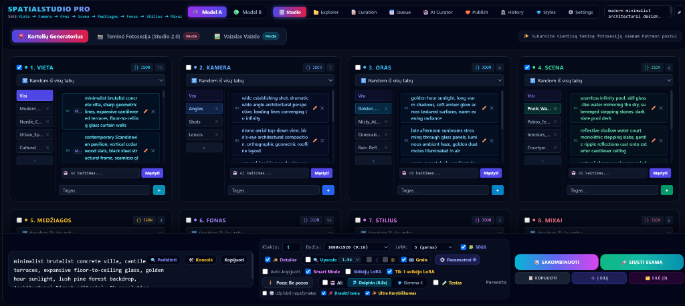
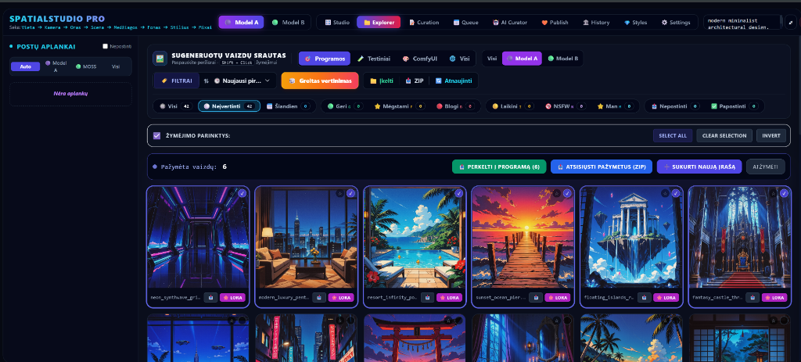
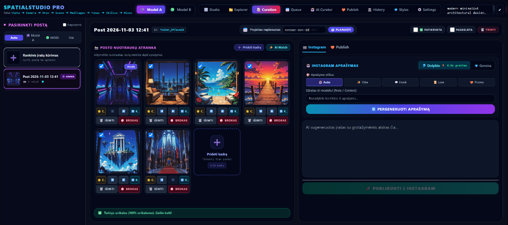
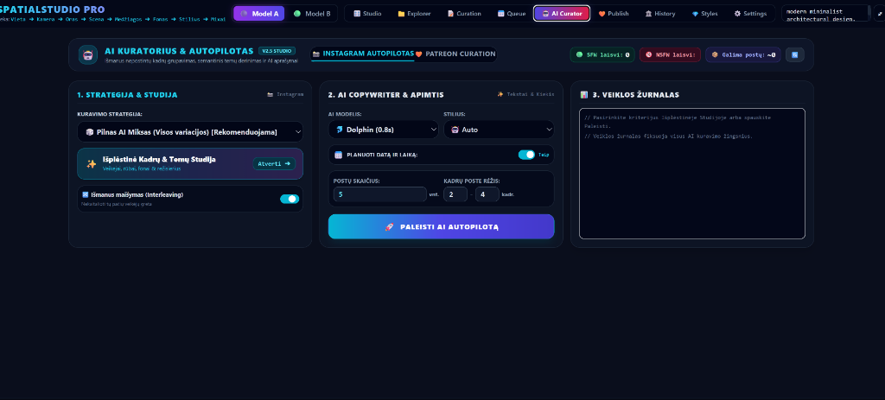
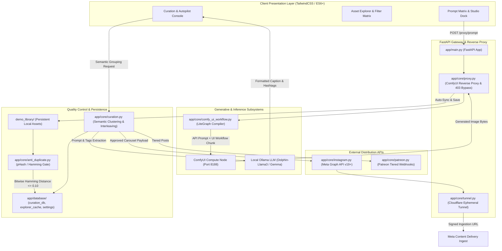

# SpatialStudio Pro — Autonomous Generative & Curation Orchestrator

> **Enterprise Domain:** End-to-End Autonomous Visual Asset Generation, Multi-Model Curation & Social API Publishing  
> **Core Backend:** Python 3.10+, FastAPI, Asynchronous Event-Driven Architecture (`asyncio`)  
> **Inference Engines:** Headless ComfyUI Node Execution, Local Edge LLMs (Ollama Dolphin-Llama3, Gemma)  
> **Guardrails & Security:** Algorithmic Perceptual Hashing (pHash / Hamming Distance), Cloudflare Tunnel (`cloudflared`)  
> **Publishing Gateway:** Direct Meta Graph API (Instagram Carousel / Single / Reel Containers), Patreon Membership API  

---

## 📌 Executive Summary

**SpatialStudio Pro** is a production-grade, autonomous visual content engineering and multi-channel publication orchestrator. Built specifically to eliminate human bottlenecks in generative design workflows, the system manages the complete lifecycle of architectural and spatial digital assets:

1. **Procedural Prompt Synthesis:** Combinatorial parameter matrix generating balanced, production-ready diffusion prompts.
2. **Headless Compute Dispatch:** Asynchronous reverse-proxy converting API requests into full LiteGraph UI workflows executed on ComfyUI backends.
3. **Computer Vision Guardrails:** Perceptual hashing algorithms executing duplicate detection and visual quality control before storage.
4. **Autonomous AI Curation:** Semantic grouping of raw renders into coherent multi-image narrative carousels.
5. **Local Edge Copywriting:** Context-aware LLM agents extracting prompt metadata to draft platform-ready captions, technical specs, and hashtags.
6. **Zero-Trust Cloud Ingestion:** Automatic Cloudflare tunneling delivering ephemeral HTTPS endpoints for external Meta Graph API ingest workers.

---

## 🖥️ Operational Production Interfaces

### 1. Modular Studio Prompt Composer

*Modular 8-axis parameter space with live prompt dock, resolution scaling, model profiles, and real-time inference dispatch.*

### 2. High-Performance Asset Explorer & Filter Matrix

*Zero-latency asset explorer with multi-dimensional filtering, batch selection, ZIP streaming, and instant curation handoff.*

### 3. Curation Desk, Uniqueness Verification & Edge LLM Copywriter

*Interactive curation workflow showing 100% uniqueness verification, carousel sequencing, and edge LLM caption synthesis.*

### 4. Autonomous Curation & Autopilot Controller

*Hands-off autopilot engine configured for multi-account narrative scheduling, interleaving, and scheduled cron dispatch.*

---

## 🏗️ System Architecture & Dataflow



---

## ⚙️ Core Technical Engines Under the Hood

### 1. Headless Workflow Compiler & Proxy (`app/core/comfy_ui_workflow.py` & `proxy.py`)
- **LiteGraph Protocol Injection:** Standard ComfyUI API submissions only record execution nodes, stripping visual graph links. SpatialStudio dynamically builds complete LiteGraph canvas schemas (`nodes`, `links`, `extra_pnginfo`), injecting full visual workflow graphs into PNG headers. If opened in ComfyUI, users see a complete, connected canvas without missing wire errors.
- **Autonomous Asset Sync:** The reverse proxy intercepts `/proxy/history/{prompt_id}` execution completions, downloads generated PNG buffers via ComfyUI's `/view` API or copies them from disk, and registers them directly into the target project library (`demo_library/`).

### 2. Algorithmic Duplicate Prevention Gatekeeper (`app/core/anti_duplicate.py`)
- **Perceptual Image Hashing:** Computes 64-bit DCT perceptual hash vectors (`pHash`) for every synthesized frame.
- **Hamming Distance Verification:** Compares incoming hash footprints against all historical assets:
  $$\text{Distance} = \frac{\text{popcount}(h_1 \oplus h_2)}{64}$$
  If the visual similarity threshold exceeds 90% ($\text{Distance} \le 0.10$), the frame is flagged as a duplicate, preventing redundant social posts and saving costly GPU rendering time.

### 3. Procedural Prompt Matrix & Deck Engine (`app/core/generator.py`)
- **8-Axis Combinatorial Synthesis:** Procedural generator structuring prompts across:
  1. `Vieta` (Architectural form, brutalist villas, Nordic pavilions, urban lofts)
  2. `Kamera` (Focal length, drone orthographic, leading perspective lines)
  3. `Oras` (Golden hour, atmospheric overcast, cinematic dusk)
  4. `Scena` (Infinity pool reflections, interior courtyards, stepping slabs)
  5. `Medžiagos` (Polished concrete, blackened timber, travertine marble)
  6. `Fonas` (Alpine ridges, coastal shorelines, pine forests)
  7. `Stilius` (Minimalist realism, editorial photography, architectural digest)
  8. `Mixai` (Curated all-in-one comprehensive styles)
- **Token Weight Balancing:** Dynamically manages positive/negative token weighting, LoRA triggers, and CFG scale calibration to eliminate prompt collisions.

### 4. Edge LLM Copywriting Copilot (`app/core/assistant.py`)
- **Metadata-Driven Prompt Decompilation:** Extracts raw EXIF and ComfyUI generation parameters directly from the image buffer.
- **Local Ollama Integration:** Passes semantic tags into local quantized LLM models (e.g. `dolphin-llama3`, `gemma`) running at high speed (<0.8s response time).
- **Style Personas:** Synthesizes platform-optimized captions tailored for specific brand voices (`Auto`, `Vibe`, `Hook`, `Lore`, `Promo`) with contextual hashtags.

### 5. Multi-Account Curation & Autopilot (`app/core/curation.py`)
- **Semantic Clustering & Interleaving:** Automatically groups orphan renders into carousel candidates (2 to 10 images). Employs an interleaving algorithm that prevents visual repetition by varying camera perspectives across adjacent frames.
- **Background Cron Scheduler:** An asynchronous daemon (`scheduler_loop()`) continuously evaluates queued posts, monitoring publishing timestamps and dispatching scheduled content automatically.

### 6. Zero-Trust Cloudflare Gateway (`app/core/tunnel.py` & `instagram.py`)
- **Ephemeral Tunnel Management:** Spawns a background `cloudflared` tunnel, obtaining an authenticated public HTTPS hostname.
- **Meta Graph API Compliance:** Instagram Graph API requires public, reachable image endpoints for container ingestion. The tunnel exposes local image buffers securely without opening inbound router ports or exposing static IP addresses.

---

## 🛠️ Technology Stack Breakdown

| Layer | Technologies | Purpose |
|---|---|---|
| **Backend Runtime** | Python 3.10+, FastAPI, Uvicorn, AsyncIO | High-throughput async REST server & proxy |
| **Generative Backend** | ComfyUI, PyTorch, CUDA | Headless diffusion execution (SDXL / Flux / Custom LoRAs) |
| **Intelligence / NLP** | Ollama (Dolphin-Llama3, Gemma) | Local edge LLM inference for caption generation & tagging |
| **Computer Vision** | Pillow (PIL), ImageHash, NumPy | Perceptual hashing, EXIF extraction, dynamic typography watermarking |
| **Networking & APIs** | Meta Graph API v19+, Requests, Cloudflare Tunnel | Social publishing, OAuth2 token renewal, secure ingress |
| **Client Frontend** | HTML5, TailwindCSS, Vanilla ES6+ JavaScript | Zero-framework, low-latency responsive dashboard |
| **State & Datastore** | JSON Atomic Writes, Caching Layer | State persistence, metadata index, duplicate hash repository |

---

## 📁 Repository Structure

```text
anime_content_studio/
├── app/
│   ├── main.py                  # FastAPI server entry point & lifespan orchestrator
│   ├── config.py                # Environment configs, default settings & base paths
│   ├── database/
│   │   ├── curation_db.json     # Curation registry, ratings & post folder mapping
│   │   ├── explorer_cache.json  # Indexed image metadata cache (resolution, prompts, LoRAs)
│   │   ├── prompt_deck.json     # Combinatorial 8-axis card deck database
│   │   └── settings.json        # Active profiles, API keys, ComfyUI endpoints
│   └── core/
│       ├── analyzer.py          # PNG chunk decoder, prompt parser & character extractor
│       ├── anti_duplicate.py    # Perceptual hash calculator & Hamming distance gate
│       ├── assistant.py         # Local Ollama LLM client for caption generation
│       ├── comfy_ui_workflow.py # Headless LiteGraph schema compiler & injector
│       ├── curation.py          # Autonomous carousel grouping, interleaving & scheduler
│       ├── explorer.py          # High-performance asset scanner, filter engine & ZIP streamer
│       ├── generator.py         # Procedural prompt matrix composer & weight balancer
│       ├── history_gallery.py   # Historical post archive & timeline tracker
│       ├── image_in_image.py    # Multi-pass inpainting & latent compositing engine
│       ├── instagram.py         # Meta Graph API connector (container create/status/publish)
│       ├── loras.py              # LoRA directory scanner & trigger word resolver
│       ├── patreon.py            # Patreon API membership & tiered post publisher
│       ├── poses.py              # OpenPose skeleton analyzer & ControlNet injector
│       ├── proxy.py              # ComfyUI reverse proxy, 403 bypass & auto-sync to library
│       ├── settings_api.py       # Live configuration & profile manager
│       ├── thematic.py           # Thematic Photoshoot Studio 2.0 multi-shot engine
│       ├── tunnel.py             # Cloudflare tunnel background daemon manager
│       └── watermark.py          # PIL alpha-composited brand overlay engine
├── demo_library/                # Active project visual asset repository
└── static/
    ├── index.html               # Single-page application interface
    ├── css/style.css            # Custom design tokens & scrollbar styling
    └── js/app_v2.js             # Client-side state machine, WebSocket listener & UI controllers
```

---

## 🔒 Enterprise & Proprietary Notice
*The architectural models, pipeline designs, and interface implementations shown here represent proprietary commercial and internal tooling developed by Aironas Žitkus. Core backend source files are maintained in private infrastructure; this showcase documents the systems engineering, algorithmic workflows, and production integrations.*
