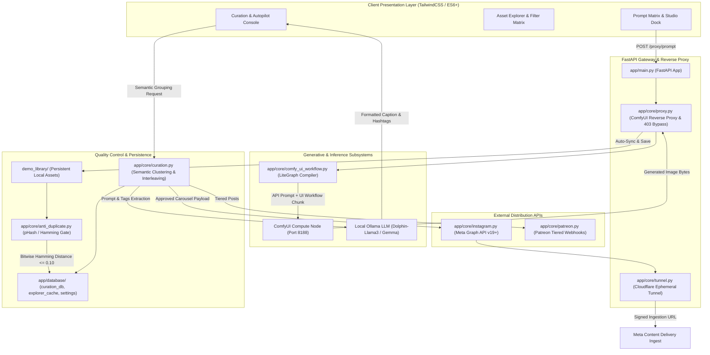

# SpatialStudio Pro — Autonomous Social Media Visual Factory & Generative Orchestrator

[](https://www.python.org/)
[](https://fastapi.tiangolo.com/)
[](https://github.com/comfyanonymous/ComfyUI)
[](https://developers.facebook.com/)
[](https://ollama.com/)
[](README.md)
[](https://www.cloudflare.com/)
[](README.md)

> **Enterprise Domain:** End-to-End Automated Social Media Content Production, Headless Diffusion Execution & Multi-Platform API Distribution  
> **Core Backend:** Python 3.10+, FastAPI, Asynchronous Event-Driven Architecture (`asyncio`)  
> **Inference Engines:** ComfyUI Headless Execution (PyTorch, CUDA), Local Edge LLMs (Ollama Dolphin-Llama3, Gemma)  
> **Computer Vision & Guardrails:** Perceptual Hashing (`imagehash.phash` / Hamming Distance), OpenPose Skeleton Detection, Dynamic Watermarking  
> **Publishing Gateway:** Direct Meta Graph API (Instagram Carousel / Single / Reel Containers), Patreon Membership API, Cloudflare Tunnel (`cloudflared`)  

---

## 🎯 What is SpatialStudio Pro? (Core Purpose & Mission)

**SpatialStudio Pro** is an **autonomous, end-to-end visual content production factory designed specifically for high-velocity social media management (Instagram, Patreon, etc.)**.

Instead of manually crafting diffusion prompts, waiting for renders, sifting through hundreds of raw files, writing captions by hand, and scheduling social media posts one by one, SpatialStudio Pro unifies the entire content pipeline into a **continuous, automated production line**:

```text
[ Procedural Prompt Synthesis ] ──▶ [ Headless ComfyUI Batch Compute ] ──▶ [ Perceptual Duplicate Guardrail ]
                                                                                         │
[ Direct Instagram/Patreon Push ] ◀── [ Local LLM Caption & Hashtags ] ◀── [ Autonomous AI Match & Curation ]
```

---

## ⚡ Key Capabilities at a Glance

### 1. 📲 Automated Social Media Publishing (Direct Instagram & Patreon API)
- **Direct 1-Click Publishing:** One-click deployment from the Curation Desk directly to Instagram via Meta Graph API v19+ or Patreon tiered posts.
- **Carousel Container Creation:** Automatically packages 2 to 10 images into verified Instagram carousel containers, monitors container processing status via webhooks/polling, and executes live publication.
- **24/7 Autopilot Background Daemon:** Set a post volume (e.g. 5 posts/day) and schedule intervals; the system runs autonomously in the background, matching images, drafting copy, and publishing at optimal engagement hours.
- **Zero-Trust Cloudflare Gateway:** Automatically manages an ephemeral `cloudflared` tunnel, exposing local image buffers via secure signed HTTPS endpoints for Meta's content ingest crawlers without requiring static public IP addresses or risky open router ports.

### 2. 🔍 Automated Asset Search, "AI Match" & Intelligent Curation
- **"AI Match" Curation Engine:** Scans the visual asset library for unposted images (`nepostinti`) and automatically clusters them by visual cohesion, color palette, and architectural style into ready-to-post albums.
- **Algorithmic Uniqueness Guarantee:** Built-in computer vision verification runs perceptual hashing (`pHash`) against the entire publication history. The interface immediately signals: `✓ Turinys unikalus (100% unikalumo)` to ensure no duplicate or near-duplicate frame is ever published twice.
- **Perspective Interleaving:** Prevents visual monotony in multi-image carousels by intentionally alternating camera angles (e.g., Wide Establishing Shot ➔ Medium Architectural Detail ➔ Atmospheric Dusk ➔ Interior Courtyard).

### 3. 🧪 Headless ComfyUI Batch Generation & Testing
- **Headless Node Dispatch:** Generates prompts and sends them asynchronously to local or remote ComfyUI compute nodes via WebSockets and REST reverse-proxy.
- **Batch Queuing (`+ Į EILĘ`):** Stack multiple variations, camera angles, and seeds into a batch queue for uninterrupted background rendering.
- **Complete Pipeline Control:** Fine-tune image dimensions (e.g. 1080x1920 9:16 vertical for Instagram Stories/Reels), sampler steps, CFG scale, 1.5x upscaling, face/detail recovery (`Detailer`), film grain simulation, and latent noise injection.
- **Bidirectional LiteGraph Injection:** ComfyUI API output typically strips visual UI canvas wires; SpatialStudio dynamically reconstructs full LiteGraph schemas (`nodes`, `links`, `extra_pnginfo`) into the PNG metadata, meaning any generated image can be dragged straight back into ComfyUI with all nodes neatly linked.

### 4. 🎛️ LoRA Preset Management & Comparative Benchmarking
- **Multi-LoRA Stacking & Weights:** Inspect, activate, and test multiple LoRA models simultaneously with granular strength weights (0.1 to 1.0).
- **Trigger Word Resolution:** Automatically detects embedded LoRA activation keywords and injects them into the positive conditioning stream.
- **Dedicated Test Mode (`Testas`):** Benchmark new model checkpoints or LoRA weight blends in an isolated test environment without polluting production asset libraries or database feeds.

### 5. ✍️ Edge AI Copywriting Copilot (Local Ollama LLMs)
- **Zero-Cloud Local Inference:** Powered by local quantization models (`dolphin-llama3`, `gemma`) running via Ollama at sub-second speeds (<0.8s).
- **Metadata-Driven Context:** Automatically decompiles the image's embedded prompt tags (location, lighting, architectural style) and drafts engaging, platform-ready captions.
- **Style Personas:** One-click tone switching across `Auto`, `Vibe`, `Hook` (viral engagement hook), `Lore` (deep technical/architectural narrative), and `Promo` (marketing call-to-action) with contextually relevant hashtags.

### 6. 🎨 Advanced Spatial Tools
- **Vaizdas Vaizde (Inpainting / Outpainting):** Mask-based localized regeneration and canvas expansion.
- **Teminė Fotosesija (Thematic Studio 2.0):** Orchestrate multi-shot visual campaigns maintaining consistent lighting and style across varying locations.
- **Pose & Structure Control (OpenPose):** Integrated skeleton detection and ControlNet injection for spatial composition.

---

## 🖥️ Production Interface Showcase

### 1. Modular Studio Prompt Composer

*Procedural 8-axis parameter space (Vieta, Kamera, Oras, Scena, Medžiagos, Fonas, Stilius, Mixai) with live prompt dock, aspect ratio selector, LoRA stack, Detailer, and batch queue dispatch.*

### 2. High-Performance Asset Explorer & Filter Matrix

*High-velocity asset management stream featuring 42 architectural demo assets, multi-select batch actions, ZIP export, and seamless one-click handoff to curation.*

### 3. Curation Desk, Uniqueness Verification & Edge LLM Copywriter

*Interactive social curation studio showing 100% uniqueness verification, carousel sequencing, and edge LLM caption synthesis.*

### 4. Autonomous Curation & Autopilot Controller

*Hands-off autopilot engine configured for multi-account narrative scheduling, interleaving, and scheduled cron dispatch.*

---

## 🏗️ System Architecture & Dataflow



---

## 🛠️ Technology Stack Breakdown

| Layer | Technologies | Purpose |
|---|---|---|
| **Backend Runtime** | Python 3.10+, FastAPI, Uvicorn, AsyncIO | High-throughput asynchronous REST server & proxy |
| **Generative Compute** | ComfyUI, PyTorch, CUDA | Headless diffusion execution (SDXL / Flux / LoRA stacks) |
| **Edge Intelligence** | Ollama (Dolphin-Llama3, Gemma) | Local quantized LLM inference for platform copywriting |
| **Computer Vision** | Pillow (PIL), ImageHash, NumPy | Perceptual hashing (pHash), EXIF parsing, dynamic typography watermark |
| **External Publishing** | Meta Graph API v19+, Patreon API, Cloudflare Tunnel | Automated carousel container creation & secure public asset ingress |
| **Client Frontend** | HTML5, TailwindCSS, Vanilla ES6+ JavaScript | Zero-framework, low-latency responsive dashboard |
| **State Persistence** | Atomic JSON Datastores, Caching Layer | Uniqueness hash index, prompt deck, and curation state |

---

## 📁 Repository Structure

```text
SpatialStudio-Pro/
├── app/
│   ├── main.py                  # FastAPI server entry point & lifespan orchestrator
│   ├── config.py                # Environment configs, default settings & base paths
│   ├── database/
│   │   ├── curation_db.json     # Curation registry, ratings & post folder mapping
│   │   ├── explorer_cache.json  # Indexed image metadata cache (resolution, prompts, LoRAs)
│   │   ├── prompt_deck.json     # Combinatorial 8-axis card deck database
│   │   └── settings.json        # Active profiles, API keys, ComfyUI endpoints
│   └── core/
│       ├── analyzer.py          # PNG chunk decoder, prompt parser & metadata extractor
│       ├── anti_duplicate.py    # Perceptual hash calculator & Hamming distance gate
│       ├── assistant.py         # Local Ollama LLM client for caption generation
│       ├── comfy_ui_workflow.py # Headless LiteGraph schema compiler & injector
│       ├── curation.py          # Autonomous carousel grouping, interleaving & scheduler
│       ├── explorer.py          # High-performance asset scanner, filter engine & ZIP streamer
│       ├── generator.py         # Procedural prompt matrix composer & weight balancer
│       ├── history_gallery.py   # Historical post archive & timeline tracker
│       ├── image_in_image.py    # Multi-pass inpainting & latent compositing engine
│       ├── instagram.py         # Meta Graph API connector (container create/status/publish)
│       ├── loras.py              # LoRA directory scanner & trigger word resolver
│       ├── patreon.py            # Patreon API membership & tiered post publisher
│       ├── poses.py              # OpenPose skeleton analyzer & ControlNet injector
│       ├── proxy.py              # ComfyUI reverse proxy, 403 bypass & auto-sync to library
│       ├── settings_api.py       # Live configuration & profile manager
│       ├── thematic.py           # Thematic Photoshoot Studio 2.0 multi-shot engine
│       ├── tunnel.py             # Cloudflare tunnel background daemon manager
│       └── watermark.py          # PIL alpha-composited brand overlay engine
├── demo_library/                # Active visual asset library
└── static/
    ├── index.html               # Single-page application interface
    ├── css/style.css            # Custom design tokens & styling
    └── js/app_v2.js             # Client-side state machine, WebSocket listener & UI controllers
```

---

## 🔒 Enterprise & Proprietary Notice
*The architectural models, pipeline designs, and interface implementations shown here represent proprietary commercial and internal tooling developed by Aironas Žitkus. Core backend source files are maintained in private infrastructure; this showcase documents the systems engineering, algorithmic workflows, and production integrations.*
